# Island

Минималистичный Dynamic Island для Windows 10/11 и Linux: чёрная (или белая) пилюля вверху экрана.
В ней показываются живые события, а по наведению она раскрывается в панель инструментов.
Сделано по мотивам [islandapp.pro](https://islandapp.pro), но строже: монохром, без маскотов,
пружинные анимации. Функций больше, чем в оригинале, и **панель собирается под себя**: какие вкладки,
в каком порядке, какие карточки и кнопки на главной, что показывает пилюля в покое.

**Стек:** Python 3.12 + PySide6 (Qt 6). Qt даёт прозрачное окно без рамки с попиксельной альфой
и одинаково работает в Windows и Linux. Всё, что зависит от системы, вынесено в `island_app/osapi`.
PyInstaller собирает приложение в один файл для каждой ОС.

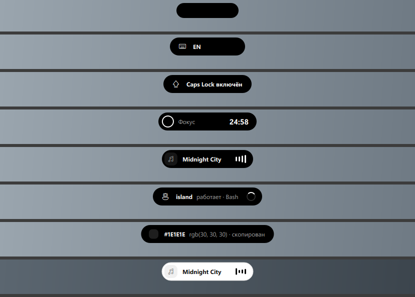

| Главная (набор «Всё») | Первый запуск |
|---|---|
| 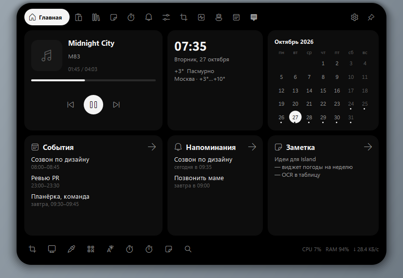 | 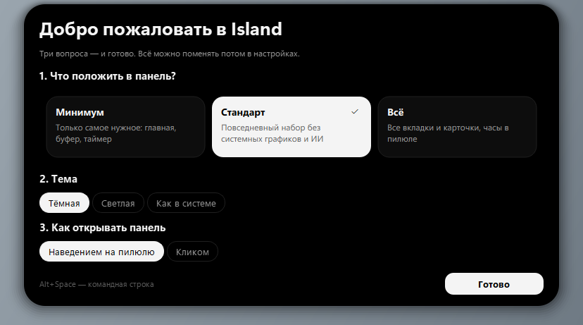 |
| **Настройки → Конструктор** | **Набор «Минимум»** |
| 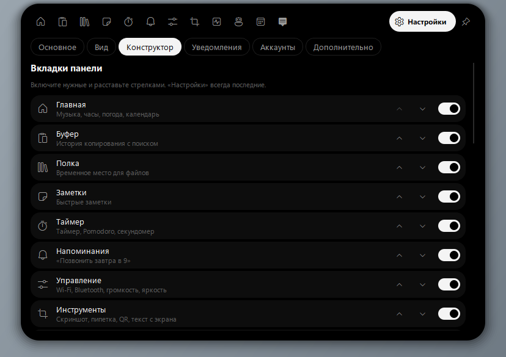 | 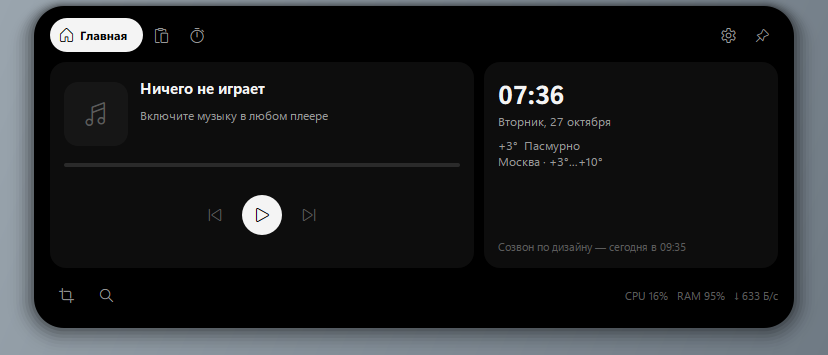 |
| **Настройки → Вид** | **Светлая тема** |
| 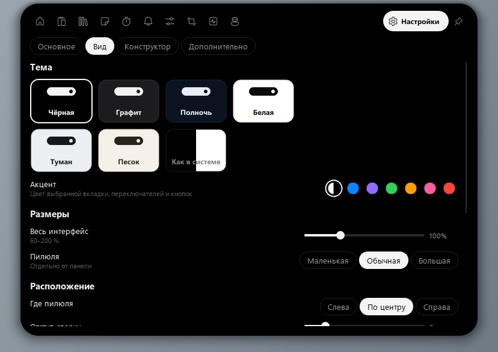 | 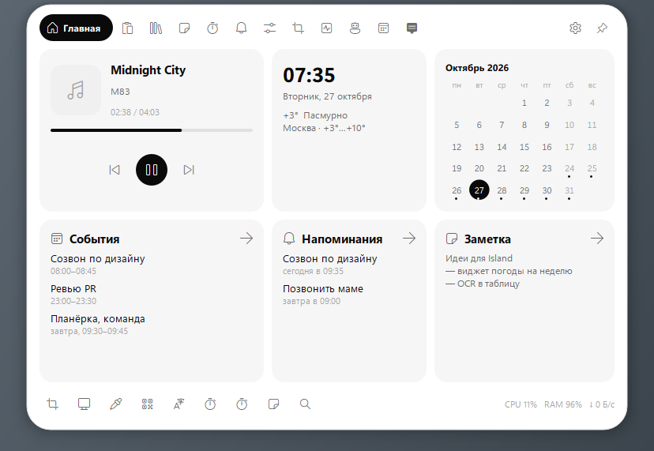 |

Уведомления всплывают из пилюли карточкой или одной строкой — как настроите:

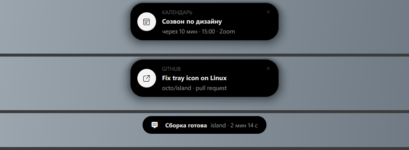

Темы «Графит», «Полночь», «Песок» и «Туман» с акцентами (последняя — в масштабе 70 %):

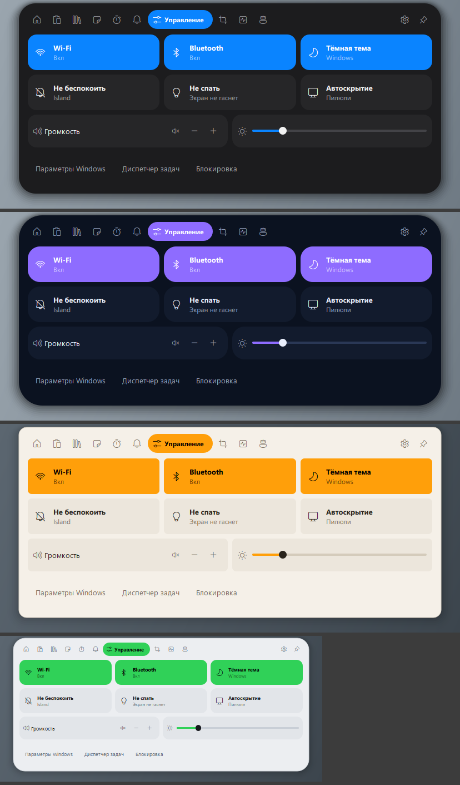

Все снимки лежат в [docs/screens](docs/screens), они сняты командой `python main.py --demo`.

## Запуск

### Windows
```bash
python -m venv .venv
.venv\Scripts\python -m pip install -r requirements.txt
.venv\Scripts\pythonw main.py
```

### Linux
```bash
bash linux/install.sh      # системные пакеты, virtualenv, команда `island` и пункт в меню
island
```
Нужен X11 или Wayland с XWayland: под Wayland Island сам запускается через XWayland, потому что
Wayland не даёт приложениям ставить окна поверх всех и задавать им позицию.

Linux-версия проверена в Ubuntu 24.04 (WSL) под Xvfb с оконным менеджером openbox. Проходят все
проверки инструментов и конструктора, а также поведение окна: клики мимо пилюли проходят насквозь,
наведение не отбирает фокус, запись из буфера вставляется в прежнее окно, командная строка
получает ввод, `Esc` возвращает фокус. Собранный `Island-linux-x86_64` проходит демо, `--action`
и `linux/install.sh`. Бинарник, собранный в Ubuntu 24.04, требует glibc этой версии или новее;
для старых дистрибутивов собирайте в Ubuntu 22.04 (так делает CI).

При первом запуске пилюля раскроется и задаст три вопроса: что положить в панель, какая тема
и как её открывать. Повторный запуск не открывает второй экземпляр, а раскрывает уже запущенный.

## Сборка одного файла

```bash
python build_exe.py
```

В Windows получится `Island.exe` (около 70 МБ), в Linux — `Island-linux-x86_64`. Собирать нужно
на той ОС, для которой нужен файл. Python на целевой машине не нужен.

В репозитории есть CI ([.github/workflows/build.yml](.github/workflows/build.yml)). На каждый push
он собирает обе версии. Linux-версию он проверяет под Xvfb: прогоняет проверки инструментов,
запускает демо из исходников и из собранного файла со скриншотами и выкладывает файл и скриншоты
как артефакты. При теге `v*` файлы прикрепляются к релизу.

## Настройка

Настройки разбиты на шесть разделов.

- **Основное.** Готовые наборы («Минимум», «Стандарт», «Всё»), размер интерфейса, открытие
  панели наведением или кликом, прятать пилюлю в полоску, автозапуск.
- **Вид:**
  - **тема:** Чёрная, Графит, Полночь, Белая, Туман, Песок или «как в системе»; карточки
    показывают превью;
  - **акцент:** монохром, синий, фиолетовый, зелёный, оранжевый, розовый, красный — цвет выбранной
    вкладки, переключателей и кнопок; текст на акценте сам становится чёрным или белым;
  - **размеры:** весь интерфейс 60–200 % и отдельно размер пилюли (маленькая, обычная, большая);
  - **расположение:** пилюля слева, по центру или справа, отступ от верхнего края 0–40 px;
  - **форма и эффекты:** углы панели (строгие, обычные, круглые), непрозрачность 60–100 %,
    тень, анимация (быстро, обычно, плавно, без анимации);
  - **шрифт:** системный или один из установленных (Segoe UI, Bahnschrift, Inter…).
- **Конструктор.** Здесь панель собирается под себя:
  - **вкладки:** включить или выключить любую и поменять порядок стрелками; выключенная вкладка
    всё равно открывается из командной строки;
  - **карточки главной:** музыка, часы и погода, календарь, графики системы, ближайшие
    напоминания, последняя заметка; до шести штук в любом порядке;
  - **кнопки под карточками:** скриншот, весь экран, пипетка, QR, OCR, таймер на 5 минут,
    Pomodoro, заметка, командная строка, блокировка;
  - **пилюля в покое:** пустая, часы или дата и время;
  - **живые события:** какие из них пилюля показывает сама.
- **Уведомления.** Как показывать: карточкой, одной строкой в пилюле или никак (только история).
  Длительность 2–15 с; звук (7 встроенных или свой .wav) и громкость; свой стиль и свой звук для
  каждого источника (календарь, GitHub, напоминания, таймер, загрузки, Claude Code, скрипты, другие
  приложения); уведомления других приложений в пилюле и список отключённых приложений;
  за сколько минут напоминать о событии; тихие часы.
- **Аккаунты.** Google Календарь, календари по iCal-ссылке, GitHub, вебхуки.
- **Дополнительно.** Ключ Claude, язык перевода, город погоды, монитор, сокрытие в полноэкранных
  приложениях, горячие клавиши, hooks Claude Code, `settings.json`, сброс.

Изменения применяются сразу. Всё хранится в `settings.json` (`layout`, `theme`, `appearance`),
файл можно править руками:
Island перечитает его на лету, а неизвестные ключи просто проигнорирует.

## Аккаунты и уведомления

### Google Календарь
Вход через браузер по OAuth 2.0 (loopback + PKCE, только чтение календаря). Google требует, чтобы
у приложения был свой OAuth-клиент, поэтому один раз нужно создать его (бесплатно):

1. [console.cloud.google.com](https://console.cloud.google.com/) → создайте проект.
2. «APIs & Services» → «Library» → включите **Google Calendar API**.
3. «OAuth consent screen» → External → добавьте свой адрес в «Test users».
4. «Credentials» → «Create credentials» → **OAuth client ID** → тип **Desktop app**.
5. Скопируйте Client ID и Client secret в Island (Настройки → Аккаунты) и нажмите «Войти через Google».

Refresh-токен и secret хранятся зашифрованными (DPAPI в Windows, файл с правами 600 в Linux).
Учитываются все календари, отмеченные в Google Календаре.

### Любые календари по ссылке (iCal)
Без входа и без своего клиента: Google («Настройки календаря» → «Секретный адрес в формате iCal»),
Outlook («Опубликовать календарь» → ссылка ICS), Яндекс («Экспорт»), Apple iCloud (публичный
календарь) и любой другой `.ics`/`webcal://`. Поддерживаются повторяющиеся события (RRULE, EXDATE),
часовые пояса и события на весь день.

### Календарь
Вкладка «Календарь» переключается между видами **Неделя** (сетка по часам, пересекающиеся события
встают рядом, линия «сейчас»), **Месяц** (6 недель с событиями в ячейках) и **Список** (две недели
вперёд). Стрелки листают недели и месяцы, «Сегодня» возвращает к текущей дате, выбранный вид
запоминается.

Свои события живут в календаре «Мой»: кнопка «+», клик по пустому месту в неделе или по дню в месяце.
Поле быстрого ввода понимает обычный язык («обед с Сашей завтра в 13»), есть «весь день», место и
повторы (каждый день / неделю / месяц / год). Свои события можно менять и удалять; события Google и
iCal открываются только для чтения, с кнопкой «Открыть в браузере».

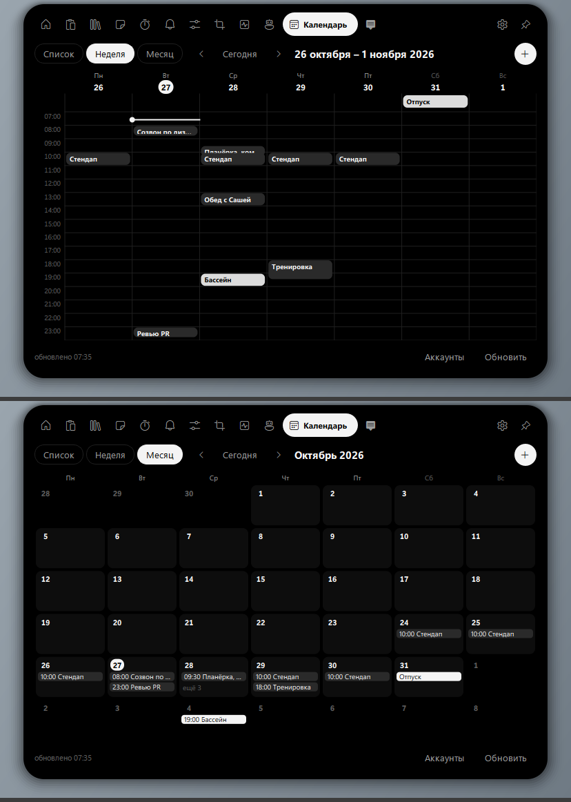

События видны также в карточке «События» на главной и точками в мини-календаре; перед началом события
всплывает уведомление.

### GitHub
Personal access token (classic) с правом `notifications` — кнопка «Создать токен» открывает
нужную страницу. Новые уведомления о PR, issues, релизах и CI всплывают в пилюле, клик открывает их
на github.com.

### Другие сервисы
Всё, что умеет вебхуки (IFTTT, Zapier, n8n, Home Assistant, свои скрипты), шлёт
`POST http://127.0.0.1:47811/notify` с `{"title": "…", "text": "…"}` — это источник «Скрипты и вебхуки».

### Уведомления других приложений
Всё, что приходит в центр уведомлений системы — мессенджеры, почта, браузер, уведомления телефона
через «Связь с телефоном», — появляется и в пилюле, с названием приложения. В Windows Island читает
базу уведомлений Windows (только чтение), в Linux слушает вызовы `org.freedesktop.Notifications`
через `dbus-monitor`. Любое приложение можно отключить в настройках. Чтобы Windows не показывала
свой баннер одновременно с пилюлей, выключите баннеры в «Параметры → Система → Уведомления»
(кнопка в настройках Island открывает этот раздел).

### Звуки
Встроенные звуки — «Капля», «Колокольчик», «Перезвон», «Маримба», «Щелчок», «Пульс», «Мягкий» — синтезируются
при первом использовании в маленькие WAV (никаких сторонних файлов), плюс системный звук, тишина или
свой `.wav`. Громкость настраивается, у каждого источника может быть свой звук, кнопка ▶ даёт
послушать.

### Как показываются уведомления
- **Карточка:** пилюля вырастает в карточку с иконкой, источником, заголовком и текстом. Пока на неё
  наведена мышь, она не исчезает. Клик открывает (событие, PR, файл), крестик или правая кнопка закрывает.
  Несколько уведомлений идут по очереди; если панель открыта, они ждут, пока она закроется.
- **В пилюле:** одна строка на время, заданное в настройках.
- **Выкл:** уведомление только попадает в историю (вкладка «Уведомления»).

Тихие часы и «Не беспокоить» глушат всё, кроме напоминаний и таймера.

## Что умеет

### Пилюля и живые события
Окно прозрачное, всегда поверх остальных, без рамки и **не забирает фокус**. Прозрачные области
пропускают клики к окнам под пилюлей: в Windows — через попиксельную альфу, в X11 — через маску
окна. Форма пилюли считается пружинной физикой, поэтому переходы между состояниями текут плавно.

| Событие | Windows | Linux |
|---|---|---|
| Музыка: обложка, название, эквалайзер, управление | SMTC (любой плеер, браузер) | MPRIS через `playerctl` |
| Таймер / Pomodoro / секундомер | ✓ | ✓ |
| Раскладка / Caps Lock | ✓ / ✓ | `xkb-switch` / ✓ (sysfs) |
| Микрофон и камера используются | реестр индикатора Windows | `pactl` / открытые `/dev/video*` |
| Загрузки браузера | ✓ | ✓ |
| Claude Code (hooks) | ✓ | ✓ |
| Прятать в полноэкранных приложениях | ✓ | `xdotool` + `xprop` |

### Панель
- **Главная:** карточки и быстрые кнопки из конструктора.
- **Буфер обмена:** история текста, картинок и файлов с поиском и закреплением. Клик **вставляет
  запись в окно, которое было активным** (в Linux — через `xdotool`). Записи от менеджеров паролей
  пропускаются.
- **Полка:** перетащите файлы на пилюлю, и они полежат здесь, пока вы не перетащите их дальше.
- **Заметки**, **таймер** (пресеты, `1ч 20м`, Pomodoro, секундомер), **напоминания** обычным языком
  («позвонить маме завтра в 9», «через 20 минут чай», «в пятницу в 18:00»).
- **Управление:** Wi-Fi и Bluetooth (WinRT Radios; в Linux — `nmcli` и `bluetoothctl`), тёмная тема
  (в Linux — GNOME `gsettings`), «Не беспокоить», «Не спать», громкость, яркость.
- **Инструменты:** скриншот с разметкой (стрелка, рамка, карандаш, маркер, текст, пикселизация),
  пипетка с лупой, QR с экрана, текст с экрана (OCR: Windows.Media.Ocr или `tesseract`), QR из буфера.
- **Система:** графики CPU, памяти и сети, диск, батарея, топ процессов.
- **Claude:** чат и перевод на вашем ключе Anthropic API (`claude-sonnet-5-5`).

### Командная строка — `Alt+Space`
| Ввод | Результат |
|---|---|
| `note`, `блокнот`, `калькулятор` | программы из меню «Пуск» (в Linux — из `.desktop`-файлов) |
| имя файла | поиск по Рабочему столу, Документам, Загрузкам и т. д. |
| `2^10 + 15% от 200` | калькулятор |
| `10 км в мили`, `100 f в c` | конвертер единиц |
| `таймер 10 мин`, `напомни … завтра в 9`, `заметка …` | таймер, напоминание, заметка |
| `? вопрос`, `tr текст` | вопрос Claude, перевод |
| `скриншот`, `пипетка`, `qr`, `ocr`, `тема`… | встроенные команды |

### Горячие клавиши
**Windows:** `Alt+Space` — командная строка · `Ctrl+Alt+I` — раскрыть · `Ctrl+Alt+V` — буфер ·
`Ctrl+Alt+S` — скриншот · `Ctrl+Alt+C` — пипетка · `Ctrl+Alt+Q` — QR · `Ctrl+Alt+O` — OCR ·
`Ctrl+Alt+N` — заметки · `Ctrl+Alt+T` — таймер · `Ctrl+Alt+A` — Claude. Сочетания меняются в
`settings.json` → `hotkeys`.

**Linux:** переносимых глобальных сочетаний нет, поэтому каждое действие доступно командой.
Назначьте её в настройках клавиатуры своего окружения:
```bash
island --action command      # также: toggle, clipboard, screenshot, picker, qr, ocr, notes, timer, ai, settings, quit
```
Те же команды работают и в Windows (`Island.exe --action screenshot`).

## Данные

Windows — `%APPDATA%\Island`, Linux — `~/.config/island`:
- `settings.json` — все настройки;
- `data.json` — заметки, напоминания, история буфера, полка, цвета; картинки из буфера — в `clips/`.

Ключ Anthropic берётся из `ANTHROPIC_API_KEY` или из настроек. В Windows он шифруется DPAPI,
в Linux файл настроек доступен только владельцу (права 600).

## Интеграция с Claude Code

Island слушает `http://127.0.0.1:47811`, только локально. Кнопка «Скопировать конфиг hooks»
(Настройки → Дополнительно) кладёт в буфер блок для `~/.claude/settings.json`: события
`UserPromptSubmit`, `PreToolUse`, `Notification`, `Stop` и `SessionEnd` отправляются через
`curl -s -m 2 -X POST http://127.0.0.1:47811/claude --data-binary @-`.
Свои уведомления: `curl -X POST http://127.0.0.1:47811/notify -d '{"title":"Сборка","text":"готово"}'`.

## Иконки

В Windows интерфейс рисуется системным шрифтом Segoe Fluent Icons. В Linux его нет, а
распространять его нельзя, поэтому в `island_app/assets/IslandIcons.otf` лежат иконки
[Material Icons](https://github.com/google/material-design-icons) (Apache 2.0, лицензия рядом),
переложенные на те же коды символов. Шрифт собирает `tools/make_icon_font.py`. Посмотреть, как
выглядит Linux-набор, можно и в Windows: `set ISLAND_BUNDLED_ICONS=1`.

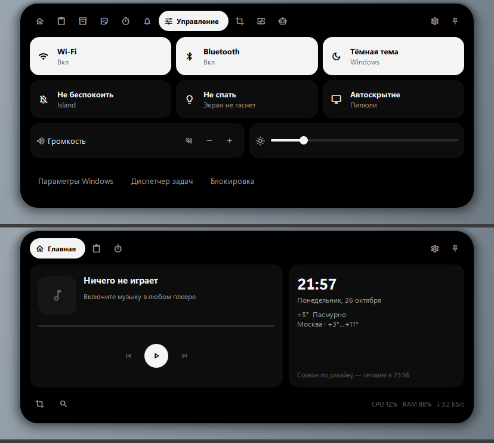

## Производительность

Замеры `tests/perf.py` в Windows: запуск ~0,55 с, пересборка интерфейса после изменения настройки
~40 мс, открытие семи вкладок подряд ~0,13 с, в простое ~0,1–0,2 % CPU, ~110 МБ памяти. Тяжёлое
вынесено из интерфейса: список процессов в Windows берётся одним системным вызовом
`NtQuerySystemInformation` (≈15 мс вместо ≈1 с у psutil), диск и батарея опрашиваются раз в 10 с,
разделы настроек строятся при первом открытии, тень во время анимации рисуется проще.

## Проверка

```bash
python tests/check_tools.py         # парсеры, QR, OCR, скриншот, пипетка (Windows и Linux)
python tests/check_layout.py        # конструктор, вид и темы, наборы, первый запуск, битый settings.json
python tests/check_integrations.py  # Google OAuth, iCal, GitHub, стили уведомлений — на подставном сервере
python tests/check_calendar.py      # неделя/месяц, свои события и повторы, звуки, уведомления других приложений
python tests/perf.py                # запуск, пересборка, открытие вкладок, CPU в простое, память
python tests/interactive_check.py   # Windows: клики насквозь, фокус, вставка, Alt+Space; двигает мышь ~15 с
# Linux (нужен оконный менеджер):
xvfb-run -a sh -c "openbox & sleep 1; python tests/interactive_check_linux.py"
python main.py --demo --exit --out docs/screens   # обход всех состояний со снимками
```
Тесты работают во временной папке (`ISLAND_HOME`), поэтому ваши данные не трогаются.

## Устройство

```
main.py                 точка входа (--action <name>, --demo)
island_app/
  app.py                контроллер: сервисы, живые события, трей, действия, наборы
  island.py             окно-пилюля: пружины, live-состояния, наведение, фокус, drag&drop, вкладки
  layout.py             из чего собирается панель и готовые наборы
  pages.py              страницы панели и командная строка
  settings_ui.py        настройки (Основное / Конструктор / Дополнительно) и первый запуск
  commands.py           разбор команд: напоминания, длительности, калькулятор, конвертер
  features.py           таймер, напоминания, буфер, индекс программ и файлов, чат с Claude
  services.py           музыка, Wi-Fi/Bluetooth, OCR (по варианту на ОС), монитор, погода, hooks
  integrations.py       Google Календарь (OAuth), iCal, GitHub
  notifications.py      центр уведомлений: источники, стили, звуки, тихие часы, история
  sounds.py             синтез и проигрывание звуков уведомлений
  calendar_ui.py        календарь: неделя, месяц, список, редактор своих событий
  capture.py            скриншот с разметкой, пипетка, выбор области
  osapi/                windows.py (Win32/WinRT) и linux.py (xdotool, playerctl, nmcli…) с общим интерфейсом
  theme.py              темы, акценты, масштаб, углы, прозрачность, анимация, шрифт
  widgets.py            свои виджеты
  assets/               IslandIcons.otf
linux/install.sh        установка из исходников в Linux
tools/make_icon_font.py сборка шрифта иконок
```

## TODO

- текст песен (LRCLIB по названию трека);
- зеркало уведомлений Windows (нужно упакованное приложение, MSIX) и D-Bus-уведомлений в Linux;
- запись экрана и голос в текст;
- статусы VPN, Steam и OBS;
- нативный Wayland (layer-shell) вместо XWayland, захват экрана через xdg-desktop-portal;
- назначение горячих клавиш из интерфейса;
- пилюля на нескольких мониторах сразу.
