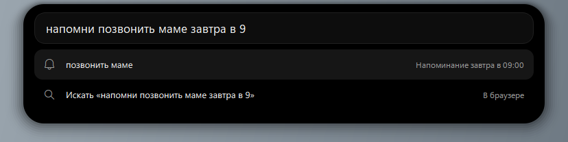
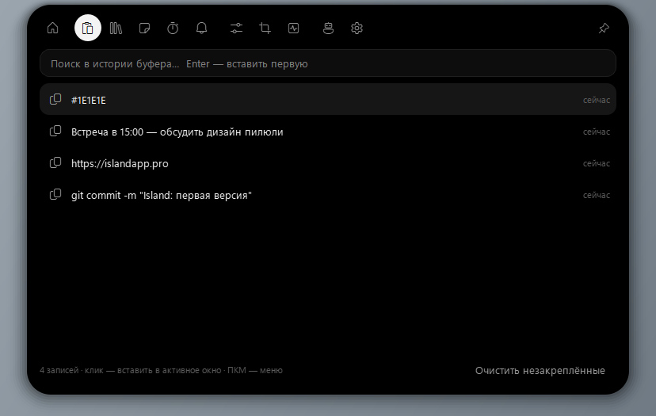
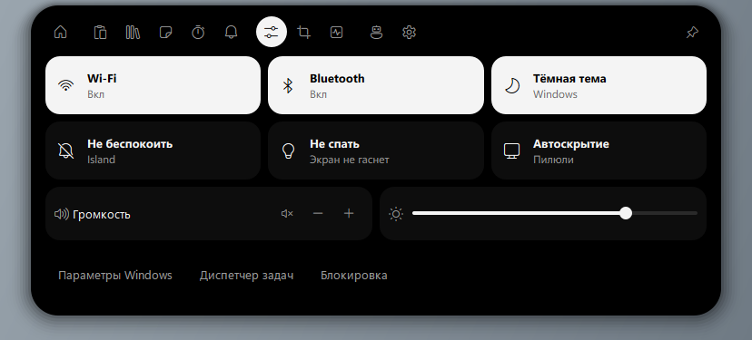
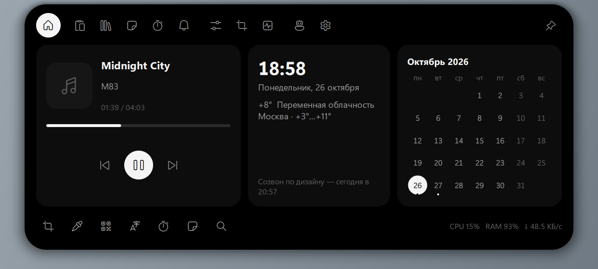

# Island

Минималистичный Dynamic Island для Windows 10/11: чёрная (или белая) пилюля вверху экрана.
В ней показываются живые события, а по наведению она раскрывается в панель инструментов.
Сделано по мотивам [islandapp.pro](https://islandapp.pro), но строже: монохром, без маскотов,
пружинные анимации. Функций больше, чем в оригинале.

**Стек:** Python 3.12 + PySide6 (Qt 6). Qt даёт прозрачное окно без рамки с попиксельной альфой,
быструю отрисовку и стили, WinRT доступен прямо из Python, а PyInstaller собирает всё в один `.exe`.


| Главная | Командная строка (Alt+Space) |
|---|---|
|  |  |
| **Буфер обмена** | **Центр управления** |
|  |  |
| **Светлая тема** | **Масштаб 150 %** |
|  |  |

Все снимки лежат в [docs/screens](docs/screens), они сняты командой `python main.py --demo`.

## Запуск

```bash
python -m venv .venv
.venv\Scripts\python -m pip install -r requirements.txt
.venv\Scripts\pythonw main.py
```

Пилюля появится вверху основного монитора, значок — в трее. Повторный запуск не открывает
второй экземпляр, а раскрывает уже запущенный.

## Сборка .exe

```bash
.venv\Scripts\python build_exe.py
```

Получится один файл `Island.exe` (около 70 МБ) рядом со скриптом. Python на целевой машине
не нужен. Автозапуск включается в настройках или в меню трея (ключ `HKCU\...\Run`).

## Что умеет

### Пилюля и живые события
Окно прозрачное, всегда поверх остальных, без рамки и **не забирает фокус** (`WS_EX_NOACTIVATE`).
Прозрачные области пропускают клики к окнам под пилюлей. Форма пилюли считается пружинной
физикой, поэтому переходы между состояниями текут плавно.

| Событие | Что видно |
|---|---|
| Музыка (Windows SMTC: Spotify, браузеры, любые плееры) | обложка, название, анимированный эквалайзер; управление на главной |
| Таймер / Pomodoro / секундомер | кольцо прогресса и обратный отсчёт |
| Раскладка и Caps Lock | короткая подсказка `EN` / `RU`, «Caps Lock включён» |
| Микрофон и камера используются | оранжевая и зелёная точки, имя приложения (то же, что читает индикатор Windows) |
| Загрузки браузера | имя и размер файла, затем «Загружено» с открытием по клику |
| Claude Code (hooks) | «работает · Bash», «ждёт ответа», «готово» |
| Пипетка, скриншоты, QR, OCR, напоминания | результат с цветовой плашкой или действием по клику |
| Полноэкранные приложения | пилюля прячется, пока игра или видео на весь экран |

### Панель (по наведению или клику; когда в ней фокус ввода, `Ctrl+1…9` переключают вкладки)
- **Главная:** что играет (с управлением и прогрессом), часы и дата, погода (Open-Meteo, без ключа),
  ближайшее напоминание, календарь месяца с отметками, быстрые действия, CPU/RAM/сеть.
- **Буфер обмена:** история текста, картинок и файлов с поиском и закреплением. Клик **вставляет
  запись в окно, которое было активным**. В контекстном меню есть копирование без вставки,
  перевод и QR из текста. Записи от менеджеров паролей (с пометкой «не сохранять в истории»)
  пропускаются.
- **Полка:** перетащите файлы на пилюлю, и они полежат на полке, пока вы не перетащите их дальше.
  Можно открыть файл, показать его в папке или скопировать.
- **Заметки:** список и редактор, всё сохраняется автоматически.
- **Таймер:** пресеты, своё время (`7`, `1ч 20м`, `90с`, `1:30`), Pomodoro 25/5 с длинным
  перерывом, секундомер.
- **Напоминания:** пишутся обычным языком («позвонить маме завтра в 9», «через 20 минут чай»,
  «в пятницу в 18:00», «25.12»). Срабатывают звуком, в пилюле и в трее.
- **Центр управления:** Wi-Fi, Bluetooth (WinRT Radios), тёмная тема Windows, «Не беспокоить»,
  «Не спать», автоскрытие, громкость, яркость (на ноутбуках).
- **Инструменты:** скриншот области или всего экрана с разметкой (стрелка, рамка, карандаш,
  маркер, текст, пикселизация, отмена; Enter копирует, Ctrl+S сохраняет в `Изображения\Island`),
  пипетка с лупой и историей цветов, QR с экрана, **текст с экрана (OCR, офлайн, Windows.Media.Ocr)**,
  генерация QR из буфера.
- **Система:** графики CPU, памяти и сети, диск, батарея, аптайм, топ процессов.
- **Claude:** чат и перевод на вашем ключе Anthropic API (модель `claude-sonnet-5-5`, ответ
  приходит потоком).
- **Настройки:** тема (тёмная, светлая, как в Windows), масштаб 80–200 %, автоскрытие,
  раскрытие по наведению, сокрытие в полноэкранных приложениях, автозапуск, монитор,
  какие живые события показывать, ключ API, город погоды.

### Командная строка — `Alt+Space`
| Ввод | Результат |
|---|---|
| `note`, `блокнот`, `калькулятор` | запуск программ из меню «Пуск», в том числе приложений Store |
| имя файла | поиск по Рабочему столу, Документам, Загрузкам и т. д. |
| `2^10 + 15% от 200`, `sqrt(16)*pi` | калькулятор, Enter копирует |
| `10 км в мили`, `100 f в c`, `5 gb в mb` | конвертер единиц (длина, масса, объём, площадь, скорость, данные, время, энергия, температура) |
| `таймер 10 мин`, `pomodoro`, `секундомер` | таймер |
| `напомни купить хлеб завтра в 9` | напоминание |
| `заметка текст` | новая заметка |
| `? вопрос`, `tr текст` | вопрос Claude, перевод |
| `скриншот`, `пипетка`, `qr`, `ocr`, `блок`, `тема`… | встроенные команды |
| `g запрос`, `yt запрос`, адрес сайта | поиск или открытие в браузере |

### Горячие клавиши (меняются в `settings.json`)
`Alt+Space` — командная строка · `Ctrl+Alt+I` — раскрыть/свернуть · `Ctrl+Alt+V` — буфер ·
`Ctrl+Alt+S` — скриншот · `Ctrl+Alt+C` — пипетка · `Ctrl+Alt+Q` — QR · `Ctrl+Alt+O` — OCR ·
`Ctrl+Alt+N` — заметки · `Ctrl+Alt+T` — таймер · `Ctrl+Alt+A` — Claude · `Esc` — свернуть.
Если сочетание занято другой программой, Island покажет это в пилюле.

## Настройки и данные

Всё лежит в `%APPDATA%\Island`:
- `settings.json` — все настройки. Файл можно править руками: изменения применяются сразу,
  перезапуск не нужен.
- `data.json` — заметки, напоминания, история буфера, полка, цвета; картинки из буфера лежат в `clips\`.

Ключ Anthropic берётся из переменной `ANTHROPIC_API_KEY`. Если его ввести в настройках,
он хранится зашифрованным через Windows DPAPI для текущего пользователя.

## Интеграция с Claude Code

Island слушает `http://127.0.0.1:47811`, только локально. В настройках кнопка «Скопировать конфиг»
кладёт в буфер блок для `~/.claude/settings.json`:

```json
{
  "hooks": {
    "UserPromptSubmit": [{ "hooks": [{ "type": "command", "command": "curl -s -m 2 -X POST http://127.0.0.1:47811/claude --data-binary @-" }] }],
    "PreToolUse":       [{ "hooks": [{ "type": "command", "command": "curl -s -m 2 -X POST http://127.0.0.1:47811/claude --data-binary @-" }] }],
    "Notification":     [{ "hooks": [{ "type": "command", "command": "curl -s -m 2 -X POST http://127.0.0.1:47811/claude --data-binary @-" }] }],
    "Stop":             [{ "hooks": [{ "type": "command", "command": "curl -s -m 2 -X POST http://127.0.0.1:47811/claude --data-binary @-" }] }],
    "SessionEnd":       [{ "hooks": [{ "type": "command", "command": "curl -s -m 2 -X POST http://127.0.0.1:47811/claude --data-binary @-" }] }]
  }
}
```

Любой скрипт может показать своё уведомление в пилюле:
`curl -X POST http://127.0.0.1:47811/notify -d "{\"title\":\"Сборка\",\"text\":\"готово\"}"`.

## Проверка

```bash
.venv\Scripts\python tests\check_tools.py          # парсеры, QR, OCR, скриншот, пипетка — 10 проверок
.venv\Scripts\python tests\interactive_check.py    # поведение окна — 11 проверок, двигает мышь ~15 с
.venv\Scripts\python main.py --demo --exit --out docs\screens   # обход всех состояний со снимками
```

`interactive_check` проверяет, что прозрачные области пропускают клики, наведение раскрывает
пилюлю без кражи фокуса, уход курсора её сворачивает, запись из буфера вставляется в прежнее окно,
а `Alt+Space` даёт фокус командной строке, после чего `Esc` возвращает его обратно.
Тесты используют `ISLAND_HOME` (временную папку), поэтому ваши данные не трогаются.

## Устройство

```
main.py                 точка входа
island_app/
  app.py                контроллер: сервисы, живые события, трей, горячие клавиши, действия
  island.py             окно-пилюля: пружины, отрисовка live-состояний, наведение, фокус, drag&drop
  pages.py              страницы панели и командная строка
  commands.py           разбор команд: время напоминаний, длительности, калькулятор, конвертер
  features.py           таймер, напоминания, история буфера, индекс программ и файлов, чат с Claude
  services.py           SMTC, Wi-Fi/Bluetooth, OCR, монитор, погода, раскладка/камера/загрузки, hooks
  capture.py            оверлеи: скриншот с разметкой, пипетка, выбор области
  winapi.py             ctypes: no-activate, фокус, SendInput, горячие клавиши, реестр
  theme.py, widgets.py  монохромная палитра, масштаб, свои виджеты
```

## TODO

Чего пока нет (в оригинале есть или напрашивается):
- текст песен (LRCLIB по названию трека из SMTC);
- зеркало уведомлений Windows (`UserNotificationListener` требует упакованного приложения, MSIX);
- запись экрана и голос в текст;
- статусы VPN, Steam и OBS (WebSocket);
- календарь Outlook/Google вместо локального;
- переназначение горячих клавиш из интерфейса (сейчас через `settings.json`);
- пилюля на нескольких мониторах сразу (сейчас один, выбирается в настройках); оверлеи захвата
  работают на мониторе под курсором;
- ползунок громкости (сейчас кнопки ±/без звука через мультимедийные клавиши).
